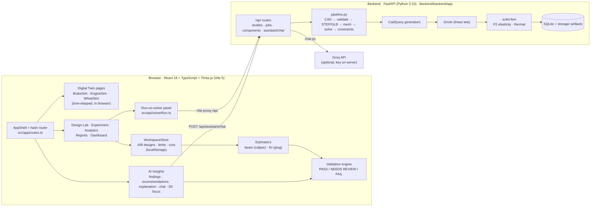
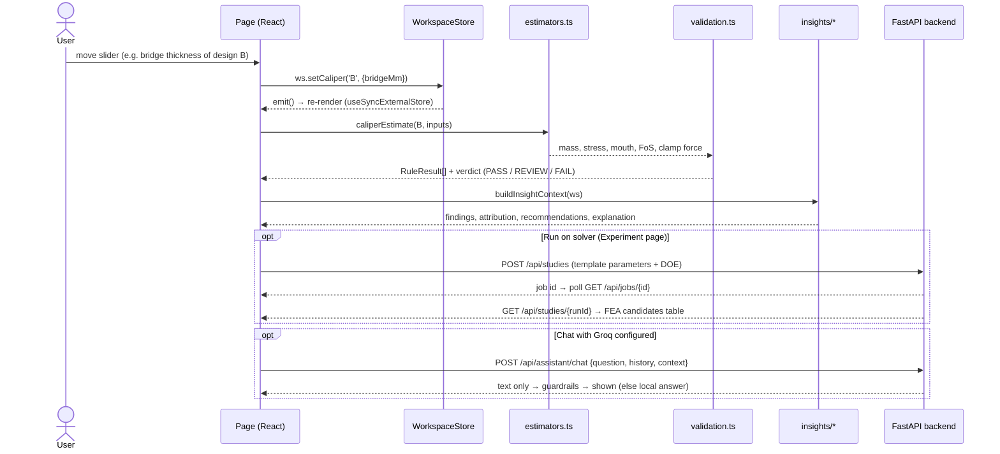

# AutoTwin: Complete System Report

**Generative engineering and interactive digital twins for automotive components**

> **Scope.** This report comes from reading the source in `D:\TWIN ANIMATION`, the frontend (`src/`) and the backend (`Backend/backend/app/`), and from running both test suites. It also inspects the solver results stored in the backend database, as of **4 Nov 2026**. Nothing in the application was changed.
>
> **How to read it.** Every claim is labelled as one of: **Implemented** (code path verified), **Partial**, **Demonstrative** (illustrative or demo values), **Not wired** (exists but the UI doesn't use it), or **Not found**. Numbers in quotes or tables come from the code, the test output or the stored runs.

---

## 1. Executive Summary

AutoTwin is a browser application (React + Three.js) with a separate Python engineering backend (FastAPI + CadQuery + Gmsh + scikit-fem). It covers three automotive components: the **brake caliper**, the **spark plug** and the **alloy wheel**.

It actually provides five things:

1. **Three interactive digital-twin pages.** Animated 3D models driven by simplified, time-stepped physics models that run in the browser: brake hydraulics and wheel dynamics, slider-crank engine kinematics, and a wheel load path. They are illustrative models, labelled as such in the UI.
2. **A Design Lab for "Design A (baseline) vs Design B (candidate)".** Editable parametric designs for the caliper and plug, plus a separate wheel lab. Instant **reduced-order estimates** (beam and fin hand-calculations) are checked against configurable demo limits by a **deterministic validation engine** that returns PASS / NEEDS REVIEW / FAIL.
3. **Experiment, Analytics, Reports and AI Insights pages** built on the same estimates. They provide controlled A/B test protocols, sensitivity sweeps, printable reports, rule-based findings, re-validated recommendations, a chat assistant (optionally worded by a Groq model via the backend) and a 3D "see the change" view.
4. **A real FEA pipeline in the backend.** Parametric CAD (CadQuery) → STEP/GLB export → tetrahedral mesh (Gmsh) → linear-elastic (caliper) or steady-state thermal (spark plug) finite-element solve (scikit-fem) → constraint checks → stored results. It is reachable from the UI through the **"Run on solver" panel on the Experiment page**. Stored runs show real outputs: the baseline caliper at **144.1 MPa peak von Mises and 0.080 mm mouth opening, 4.487 kg**, solved on about 53,000 DOF in 54–87 s.
5. **Honesty machinery.** Every number carries a badge (Input / Derived / Model / Estimated / Demo fixture). AI text passes guardrails that reject certification claims and contradictions of a verdict.

**What AutoTwin cannot honestly claim today:**
- The browser estimates are **not calibrated** against the backend FEA.
- The **Design Lab A/B designs are not what the solver runs.** The solver runs the backend's own template plus DOE candidates.
- Nothing is **validated against physical tests.**
- The twins are **not connected to live sensor data**, so they are interactive virtual prototypes rather than operational digital twins.

---

## 2. Problem Statement and Project Vision

**Problem.** Component design decisions (thicker bridge? longer insulator nose? other material?) usually require a CAD edit, a meshing step and an FEA run. Each takes minutes to hours, and the person deciding often doesn't see how a parameter actually moves stress, stiffness or temperature. Interactive intuition (sliders, animation) and rigorous analysis (FEA) usually live in different tools.

**Vision.** One workspace where an engineer:
- sees the component working (twin);
- edits a candidate next to a baseline (Design Lab);
- gets instant, clearly labelled estimates and pass/fail checks;
- asks *why* and *what if* (AI Insights);
- confirms promising candidates with real FEA (backend solver).

All of it with provenance on every number.

**Intended users.** Component R&D engineers, design reviewers, engineering students and educators, and supplier engineering teams doing early-stage trade studies.

**What makes the current build distinctive:**
- One deterministic rule engine feeds every page.
- Recommendations are found by search and re-validated before they're shown.
- A 3D focus view morphs the exact part being changed and recomputes estimates at every in-between shape.
- The backend refuses to drop or rescore failed candidates and records failure reasons (seen in the stored runs).

**Not claimed:** cost savings, accuracy figures beyond the solver benchmarks, production readiness, or industry adoption.

---

## 3. Product Capabilities and Current Scope

| Capability | Status | Evidence |
|---|---|---|
| Brake caliper twin (animated, time-stepped) | **Implemented, demonstrative physics** | `src/modules/brakeCaliper/sim/brakeModel.ts` (`BrakeSim.step`) |
| Spark plug / inline-4 engine twin | **Implemented: kinematics exact, tip temperatures user-entered** | `src/modules/sparkPlug/engine/kinematics.ts`, `sim/engineSim.ts` |
| Alloy wheel twin | **Implemented, demonstrative physics** | `src/modules/alloyWheel/sim/wheelModel.ts`, `sim/loads.ts` |
| Design Lab A/B (caliper, plug) with estimates and checks | **Implemented (reduced-order)** | `src/pages/DesignLabPage.tsx`, `src/workspace/estimators.ts`, `validation.ts` |
| Design Lab A/B for the wheel | **Implemented (separate store)** | `src/modules/alloyWheel/lab/WheelLabStore.ts`, `evaluate.ts` |
| Experiment protocols (A vs B under identical conditions) | **Implemented** | `src/workspace/experiments.ts` |
| Backend FEA "Run on solver" | **Implemented, reachable from the Experiment page** | `src/api/solverRun.ts`, `Backend/backend/app/services/pipeline.py` |
| Analytics (sensitivity) and Reports (print / HTML / MD / JSON) | **Implemented (estimates only)** | `src/workspace/analytics.ts`, `report.ts`, `src/pages/ReportsPage.tsx` |
| AI Insights: verdicts, findings, recommendations, explanation | **Implemented (deterministic)** | `src/insights/*` |
| AI chat with Groq LLM wording | **Implemented; needs backend running and `GROQ_API_KEY` set** | `src/insights/chat/groqProvider.ts`, `Backend/backend/app/api/routes/chat.py` |
| 3D focus / A→B morph viewer | **Implemented** | `src/insights/focus/FocusViewer.tsx` |
| Backend NSGA-II optimisation | **Not wired:** exists in backend, UI only submits `strategy: 'doe'` | `app/engineering/optimization/nsga2.py`; `solverRun.ts buildRequest` |
| Backend requirement parser, study explainer, cost model, report generator | **Not wired:** client methods exist, no page calls them | `src/api/client.ts` (`interpret`, `explainStudy`, `estimateCost`, `generateReport`) |
| FEA field visualisation (stress / temperature on the mesh) in the UI | **Not wired:** solver panel shows tables only | `src/api/SolverRunPanel.tsx` (no `visualization` call) |
| Live sensor data / operational twin | **Not found** | – |
| Physical test validation | **Not found** | – |

---

## 4. System Architecture

### 4.1 Architecture diagram



### 4.2 End-to-end data flow



### 4.3 Stage-by-stage trace

| # | Stage | Responsible code | Runs where |
|---|---|---|---|
| 1 | User opens AutoTwin | `index.html` → `src/main.tsx` → `src/App.tsx` (switch on `useRoute()`) | Browser |
| 2 | Selects a section or module | `src/app/routes.ts` (`parseHash`, `navigate`); `src/shell/AppShell.tsx`; `ModuleSwitch.tsx` | Browser |
| 3 | 3D view and controls load | `BrakeCaliperDashboard.tsx` / `SparkPlugDashboard.tsx` / `AlloyWheelDashboard.tsx`; `DesignLabPage.tsx` | Browser (WebGL) |
| 4 | Changes a parameter | Twins: `sim.setParams(...)`. Workspace: `ws.setCaliper / setPlug / setCaliperInputs` (`WorkspaceStore.ts`) | Browser |
| 5 | Inputs processed or validated | Sliders clamp to ranges (`SliderField` in `src/ui/primitives.tsx`); rules in `src/workspace/validation.ts` | Browser |
| 6 | Visual update | Twins read sim state each frame in `useFrame`; Design Lab A/B 3D in `src/pages/LabAB3D.tsx` → `ABLabViewer` (exported from `src/insights/focus/FocusViewer.tsx`) | Browser |
| 7 | Engineering calculation | Twin physics (`BrakeSim.step`, `EngineSim.advanceSim`, `WheelSim`); estimates (`caliperEstimate`, `plugEstimate`); backend FEA only when "Run on solver" is pressed | Browser / backend |
| 8 | Results shown | KPI cards, telemetry panels, `LineChart.tsx`, `ABChart.tsx`, check lists, solver table (`SolverRunPanel.tsx`) | Browser |
| 9 | AI insights | `src/insights/context.ts` → `findings.ts`, `recommendations.ts` → `explain/localProvider.ts`; chat in `chat/engine.ts`, optional `groqProvider.ts` | Browser (+ backend for Groq) |
| 10 | Compare and decide | Experiment runs, Analytics, Reports, AI Insights plan → "Finalize decision" (`ChatStore.recordDecision`) | Browser |

### 4.4 Technology and data flow facts

- **Frontend:** React 18.3.1, TypeScript 5.6, Vite 5.4, three 0.169, @react-three/fiber 8.17, @react-three/drei 9.121. No chart library: charts are hand-written canvas or SVG. No router library: routing is by URL hash.
- **State:** `SimStore` (`src/core/SimStore.ts`) is an observable base class; React subscribes via `useSyncExternalStore` (`useStoreVersion.ts`). The twins update their state every frame, while React re-renders are throttled to about 15 Hz. `WorkspaceStore` and `ChatStore` save to **localStorage**, so they are per browser and not shared.
- **Backend:** FastAPI on port 8000 with SQLite. Artifacts are stored under `Backend/storage/`. A background job manager runs studies. The dev server proxies `/api` to it (`vite.config.ts`).
- **When the backend is down:** the shell's chip shows "Backend offline" (`src/api/useBackend.ts` polls `/api/health` every 15 s). Twins, Design Lab, Experiment protocols, Analytics, Reports and AI Insights keep working, because they are browser-only. The solver panel cannot run, and the chat falls back to local rule-based answers.
- **At audit time:** the backend was not listening on port 8000.

---

## 5. Repository and Technology Stack

```
D:\TWIN ANIMATION
├─ index.html, vite.config.ts (proxy /api → :8000), package.json, tsconfig.json
├─ src/
│  ├─ main.tsx, App.tsx              entry + page switch
│  ├─ app/routes.ts                  hash routes for 8 sections + 3 twin modules
│  ├─ shell/                         AppShell (top nav, sidebar, backend chip), ModuleSwitch, ComponentSwitch, CommandPalette
│  ├─ theme/                         theme.css, pastel.css, themeMode.ts (light pastel default + dark)
│  ├─ core/                          SimStore, useStoreVersion
│  ├─ ui/                            primitives (Panel, Badge, SliderField…), LineChart, ABChart, TwinWorkspace
│  ├─ three/                         common.tsx (studio environment, CameraRig), geometry.ts (extrude/lathe helpers)
│  ├─ modules/
│  │  ├─ brakeCaliper/               BrakeSim + 3D assembly + panels + dashboard
│  │  ├─ sparkPlug/                  kinematics, linkage, combustion visual, EngineSim, EngineScene, fire shader
│  │  └─ alloyWheel/                 WheelSim, loads, drawing-based geometry, materials, lab (A/B)
│  ├─ workspace/                     designs, estimators, validation, metrics, experiments, analytics, report, WorkspaceStore
│  ├─ insights/                      context, findings, recommendations, explain/, chat/, focus/
│  ├─ pages/                         Dashboard, DesignLab, LabAB3D, Experiment, Analytics, Reports, AIInsights
│  └─ api/                           client.ts, types.ts, useBackend.ts, solverRun.ts, SolverRunPanel.tsx
├─ scripts/                          8 Node check suites (sim, engine, workspace, insights, experiment, chat, wheel, analytics)
└─ Backend/backend/app/
   ├─ main.py                        FastAPI app, routers under /api
   ├─ api/routes/                    health, projects, studies, jobs, assets, assistant, chat, cost, reports, estimate
   ├─ engineering/cad/generators/    brake_caliper.py, spark_plug.py, alloy_wheel.py (CadQuery)
   ├─ engineering/meshing/           gmsh_runner.py
   ├─ engineering/solvers/           skfem_structural.py, skfem_thermal.py, linear_algebra.py, registry.py
   ├─ engineering/profiles/          per-component inputs, load cases, objectives, constraints
   ├─ engineering/optimization/      sampling (LHS DOE), nsga2, evaluation, ranking
   ├─ engineering/assurance/         pre/post-solver gates, evidence, maturity levels
   ├─ engineering/ai/                requirement_parser.py, result_explainer.py
   └─ services/                      pipeline.py, job_manager.py, study_service.py, report_service.py
```

**Backend stack** (`requirements.txt`): fastapi 0.162, uvicorn 0.54, pydantic 2.14, SQLAlchemy 2.0, numpy 2.2, scipy 1.15, trimesh 5.2, meshio 5.3, CadQuery 2.7, gmsh 4.15, scikit-fem 12.0, pymoo 0.6, httpx 0.28. Python 3.10.

**Commands:**
- Frontend: `npm install`; `npm run dev` (port 5173); `npm test`; `npm run build`.
- Backend: `cd Backend\backend`; `.venv\Scripts\python -m uvicorn app.main:app --host 127.0.0.1 --port 8000`; `pytest -m "not slow"`; `pytest -m benchmark`.

**Configuration:** `Backend/backend/.env` (git-ignored) holds the optional `GROQ_API_KEY` and `GROQ_MODEL` (default `openai/gpt-oss-120b`); `.env.example` documents the rest.

**Responsible files**

| Concern | File(s) / function(s) |
|---|---|
| Spark plug rendering | `src/modules/sparkPlug/three/EngineScene.tsx` (`SparkPlug`, `Cylinder`), `fireMaterial.ts`; focus view: `src/insights/focus/FocusViewer.tsx` (`PlugFocus`) |
| Brake caliper rendering and animation | `src/modules/brakeCaliper/three/BrakeAssembly.tsx` (`Rotor`, `Wheel`, `CaliperHalf`, `Caliper`), `BrakeScene.tsx` (`SimDriver`); focus view: `CaliperFocus` |
| Design A / B definitions | `src/workspace/designs.ts` (`CALIPER_BASELINE`, `PLUG_BASELINE`), `WorkspaceStore.ts` (`freshCaliper`, `freshPlug`); wheel: `WheelLabStore.ts` |
| Parameter controls | `DesignLabPage.tsx` (`CaliperFields`, `PlugFields`, `InputsPanel`); twins: `ParametersPanel.tsx`, `EngineParametersPanel.tsx`, `WheelParametersPanel.tsx` |
| Engineering calculations | `estimators.ts` (`caliperEstimate`, `plugEstimate`), `brakeModel.ts` (`step`), `kinematics.ts`, `wheelModel.ts` / `loads.ts`; backend `skfem_*.py` |
| Verdicts | `validation.ts` (`CALIPER_RULES`, `PLUG_RULES`, `validateBoth`) |
| AI insights | `src/insights/` (`context.ts`, `findings.ts`, `recommendations.ts`, `explain/*`, `chat/*`) |
| Charts and result panels | `src/ui/LineChart.tsx`, `src/ui/ABChart.tsx`, `ExperimentPage.tsx`, `AnalyticsPage.tsx` |
| Backend API calls | `src/api/client.ts` (`api.*`), `src/api/solverRun.ts` |
| CAD, meshing, FEA | `Backend/backend/app/engineering/cad/generators/*.py`, `meshing/gmsh_runner.py`, `solvers/skfem_structural.py`, `skfem_thermal.py`, `services/pipeline.py` |

---

## 6. Complete User Journey

1. **Dashboard** (`#/dashboard`) shows:
   - a hero section, component tiles (Brake Caliper, Spark Plug, Alloy Wheel) with the current A/B verdicts;
   - workspace KPIs (designs passing every check, experiment runs);
   - a clickable workflow strip, recent activity, and a "What's real in this build" table.
2. **Digital Twin** (`#/digital-twin/brake-caliper | spark-plug | alloy-wheel`) shows an animated 3D model, a parameter panel, KPI cards, live telemetry and charts. Play / Pause / Reset; view presets.
3. **Design Lab** (`#/design-lab`): choose the component, then edit **Design A (baseline)** and **Design B (candidate)** side by side. You see:
   - the steady-state preview (estimates) with the A/B verdict;
   - a check list and a parameter-differences table;
   - the load case and limits (demo fixtures);
   - an A/B 3D view (`LabAB3D`).
4. **Experiment** (`#/experiment`): pick a protocol and conditions, then run. Both designs go through the same test, and you get a results table, A/B charts and a run history. The "What changed A → B" 3D panel animates A into B. **"Run on solver"** submits a backend FEA study.
5. **Analytics** (`#/analytics`): sensitivity of each output to each parameter, for A and B.
6. **AI Insights** (`#/ai-insights`):
   - verdict cards, a summary, and a parameter-by-parameter validation table with "why?" for each row;
   - the 3D focus view of the recommended change;
   - recommendations with Apply / Show in 3D / Add to plan;
   - findings and the chat ("Ask AutoTwin");
   - a draft plan → **Finalize decision**.
7. **Reports** (`#/reports`): choose sections, preview, then print to PDF or download HTML / Markdown / JSON.

| Screen / Module | User Action | Input / Parameter | System Response | Output | Implementation Status |
|---|---|---|---|---|---|
| Brake twin | Press **Brake** / hold Space | Line pressure 0–15 MPa (default 4) | Pressure lag → piston travel → clamp → torque → decel → rotor heats | Pressure, torque, decel, rotor °C, stop distance and time | Implemented, illustrative model |
| Brake twin | Change piston bore / pistons per side | 28–44 mm (38); 1–3 (2) | Larger area → more clamp force and torque | Same readings | Implemented |
| Brake twin | Pad μ, road μ, mass, speed | 0.2–0.6 (0.4); 0.2–1.2 (1.0); 200–800 kg (400); km/h (80) | Torque or grip limit, inertia | Grip-limited warning when torque exceeds μ·m·g·R | Implemented |
| Spark twin | Engine speed | 0–7000 rpm (3000) | Crank angle advances; pistons, rods, firing 1-3-4-2, fire | Crank angle, strokes, ignition rate | Implemented (exact kinematics) |
| Spark twin | Tip temperatures A / B | °C, default 620 / 700 | Tip colour and heat-range status | Tip status vs 450–850 °C | **Demonstrative** (typed values, labelled "entered values, not solver output") |
| Spark twin | Plug geometry | nose 3–14 mm, nose Ø 4–9, electrode Ø 0.6–3, protrusion 0–5, reach 12–26.5 | Plug geometry in 3D changes | Visual only (no temperature link) | Visual |
| Alloy wheel twin | Scenarios (cruise, brake stop, cornering, rigs), design inputs | per `WheelParametersPanel.tsx` | Load transfer, spoke loads and stresses, fatigue ranking | Spoke stresses, rig results | Implemented, illustrative ("not a life prediction") |
| Design Lab | Edit B parameters or material | see §9 | Estimates and checks recompute instantly | Mass, stress, mouth, FoS, clamp / tip temp, heat flow | Implemented (reduced-order) |
| Design Lab | Edit load case and limits | see §9 | All verdicts re-evaluated | PASS / REVIEW / FAIL per rule | Implemented (demo fixtures) |
| Experiment | Run protocol | speed, pressure, μ, mass / rpm, load | A and B run through the identical test | Metrics table, A/B charts, recorded run | Implemented |
| Experiment | Run on solver | material, engineering inputs, candidates, mesh preset | Backend CAD → mesh → FEA for the template plus DOE candidates | FEA table (mass, von Mises, displacement or temperature, feasibility) | Implemented (template, not the A/B designs) |
| AI Insights | Apply / Show in 3D / Add to plan | recommendation patch | Design B updated / focus morph / draft plan | New verdicts; animated part | Implemented |
| AI Insights | Chat question | free text | Intent engine (+ Groq wording if configured) | Answer, before/after table, action buttons | Implemented |
| Reports | Print / Download | section selection | Builds report from the workspace | PDF / HTML / MD / JSON | Implemented (estimates only) |

---

## 7. Spark Plug Module

### 7.1 Types actually present

There are no catalogue spark-plug "types" (such as hot / cold part numbers) in the code. What exists:

1. **Plug A and Plug B in the engine twin**, `SparkPlugDashboard.tsx` / `EngineScene.tsx`. They are installed as a **split arrangement in one inline-4: Plug A in cylinders 1 and 4, Plug B in cylinders 2 and 3**.
   - **Both use the same geometry** (one `plug: PlugGeometry` passed to every cylinder).
   - **They differ only by their seat-ring colour (amber / cyan) and their user-entered tip temperatures** (`tipTempA` 620 °C, `tipTempB` 700 °C, labelled demo fixtures).
   - In the twin, A vs B is therefore a **visual and entered-value** difference, not an engineering one.
2. **Design A and Design B in the Design Lab** (`designs.ts` → `PlugDesign`): genuinely parametric designs evaluated by the fin estimator (§7.3).
3. **The backend spark-plug template** (`app/engineering/cad/generators/spark_plug.py`): a CadQuery three-material assembly (electrode, insulator, shell) solved with 3D steady-state thermal FEA.

### 7.2 Engine twin: what is calculated

- **Kinematics (exact):** slider-crank geometry (`kinematics.ts`): reference 2.0 L inline-4, 86 × 86 mm, rod 143.5 mm, firing order 1-3-4-2, 720° cycle, stroke labels.
  - Verified by 39 checks (`npm run test:engine`): the piston never exceeds its stroke, and exactly one cylinder fires per 180°.
- **Combustion fire:** a GLSL shader driven only by crank angle (`combustionVisual.ts`): spark at 18° BTDC, the flame front crosses in about 48°, and the glow fades by about 182° ATDC. It is a **visual envelope, not a heat-release model**.
- **Not calculated in the twin:** plug temperature, electrode wear, ignition energy, spark gap physics. The UI says tip temperatures are "entered values, not solver output".

### 7.3 Design Lab spark plug: fin estimate (browser)

`plugEstimate()` in `src/workspace/estimators.ts` treats the insulator nose and centre electrode as one fin:

`T_tip = T_gas − (T_gas − T_seat) / cosh(m·L)`, with `m = √(h·P / Σk·A)` and `L = nose length + ½·protrusion`.

`h = h_ref · (rpm/3000)^0.8 · (0.3 + 0.7·load)`.

| Parameter | Default | Range | Effect in code |
|---|---|---|---|
| Insulator nose length | 7.5 mm | 3–15 | ↑ length → ↑ m·L → **hotter tip** (main heat-range lever) |
| Insulator nose Ø | 6.2 mm | 4.5–8.5 | Changes perimeter and conduction area; ↑ insulator wall |
| Centre electrode Ø | 2.5 mm | 0.6–3.0 | ↑ conduction area → **cooler tip**; ↓ insulator wall |
| Firing-end protrusion | 2.0 mm | 0–5 | Adds ½·protrusion to fin length → hotter |
| Insulator material | Alumina 95 % (k = 12) | 99.5 % (k = 16) | Higher k → slightly cooler |
| Electrode material | Ni + Cu core (k = 120) | Solid Ni (k = 20) | Solid Ni → much hotter tip |

**Load case and limits (demo fixtures):** gas 900 °C, seat 200 °C, h_ref 1200 W/m²K at 3000 rpm, operating point 3000 rpm / 100 % load, minimum insulator wall 1.0 mm.

**Rules** (`PLUG_RULES` in `validation.ts`):
- tip ≥ 450 °C and tip ≤ 850 °C at the operating point (review band ±30 °C);
- hottest tip across a full-load 800–7000 rpm sweep ≤ 850 °C;
- tip at idle (800 rpm, 20 %) ≥ 450 °C, which is **flagged NEEDS REVIEW, not FAIL**;
- insulator wall ≥ minimum.

**Baseline values** (checked by `npm run test:workspace` / `test:insights`):
- tip **567 °C** at the operating point, hottest **701 °C**, idle **290 °C**;
- heat to the seat 89.0 W, m·L 1.38;
- verdict **NEEDS REVIEW** (idle fouling).

This is honest: the reference plug runs below self-cleaning temperature at idle under these demo inputs.

**Typical demonstration:**
- Set B's nose to **5 mm**: tip **436 °C → FAIL**.
- The recommendation engine proposes **nose 5.0 → 5.8 mm** (tip about 481 °C, PASS on that check). It finds this by search and re-validates it.
- Set B's nose to **14 mm with solid nickel**: hottest tip **891 °C → FAIL** (pre-ignition).

### 7.4 Backend spark plug: real thermal FEA

**Template parameters** (backend defaults):
- Design variables: nose length 7.5 mm, insulator Ø 6.2 mm, centre electrode Ø 2.5 mm, electrode length 30 mm.
- Fixed: thread 14 mm, reach 17.5 mm, **electrode gap 0.8 mm**, protrusion 2 mm, shell 22 mm, insulator length 44 mm.

**Materials:** alumina 96 / 99, nickel-alloy electrode, copper core, low-carbon steel shell.

**Load case:** 900 °C gas at 500 W/m²K on the combustion-exposed surfaces, 150 °C seat, 80 °C plug-well air at 25 W/m²K.

**Constraint:** max temperature in [450, 850] °C, minimum section 1 mm.

**Stored runs** (`Backend/backend/autotwin.db`):
- 4 solves, about **1.1–1.9 s** each, roughly 11–13 k DOF.
- Max temperatures **458, 560, 622 °C** (feasible) and **384 °C** (infeasible: "heat_range_window violated").

**Note on the electrode gap:** it exists only in the backend CAD (fixed 0.8 mm). Neither the estimator nor the twin models the gap, so no ignition or gap physics is implemented anywhere.

---

## 8. Brake Caliper Module

### 8.1 Variants actually present

1. **The brake twin** (`BrakeCaliperDashboard.tsx`): one fixed, opposed caliper with **no A/B**. Its piston count (1–3 per side) and bore (28–44 mm) are adjustable and change the hydraulics and the 3D pistons. Its body geometry uses fixed dimensions (`DIM` in `BrakeAssembly.tsx`: Ø330 × 28 mm vented rotor, 40 vanes).
2. **Design Lab Design A and Design B** (`CaliperDesign`): genuinely parametric for the estimator.
3. **The backend caliper template** (`brake_caliper.py`): a CadQuery solid with named regions (piston bore, pad abutments, mounting holes), solved with linear-elastic FEA.

### 8.2 Brake twin: what the code computes

From `BrakeSim.step` (`brakeModel.ts`), at fixed 1 ms steps of simulated time:

1. **Hydraulics:** first-order lag toward the setpoint (τ apply 0.06 s, release 0.12 s).
2. **Pistons:** travel = running clearance (0.15 mm) up to a 0.25 MPa contact pressure, then 0.012 mm/MPa compliance. Drawn 33× larger so it's visible.
3. **Clamp force per side:** `F = (p − 0.25 MPa) · n · π d²/4`.
4. **Brake torque:** `T = 2 · μ_pad · F · r_eff` (two pad faces; r_eff = 0.135 m), capped at the tyre grip torque `μ_road · m · g · R` (ideal ABS, so the wheel never locks; a "grip-limited" flag is shown).
5. **Wheel:** `J = m·R² + 1.6 kg·m²`, `J·dω/dt = T_drive − T_brake − T_resist`, rolling without slip, with rolling resistance and drag.
6. **Rotor temperature:** a lumped 9.5 kg cast-iron mass absorbs 90 % of the friction power, with speed-dependent convection. It is an **estimate (trend), not a surface temperature.**

**The three force quantities:**
- **Hydraulic force per piston** = p × piston area.
- **Clamp force per side** = sum over that side's pistons, minus the contact-pressure offset in the twin.
- **Brake torque** = 2 faces × μ × clamp force × effective radius.

The twin is *opposed*: both sides push, and the clamp force per side equals the normal force on each pad face.

**Not modelled in the twin:**
- caliper stress or deformation;
- pad wear and μ changing with temperature;
- weight transfer;
- brake-torque reaction into the caliper body.

### 8.3 Brake pressure (bite force) experiment for judges

These figures are hand-computed from the formulas in §8.2 at the twin defaults (80 km/h, bore 38 mm, 2 pistons per side, μ 0.4, r_eff 0.135 m, 400 kg, road μ 1.0, R = 0.33 m). The UI shows the same quantities live.

1. **Default, 4 MPa:**
   - Clamp per side = 3.75 MPa × 2,268 mm² ≈ **8.5 kN**.
   - Torque ≈ 2 × 0.4 × 8,506 × 0.135 ≈ **919 N·m**.
   - Deceleration ≈ T·R/J ≈ 919 × 0.33 / 45.2 ≈ **6.7 m/s² (0.68 g)**; not grip-limited.
2. **Raise the pressure to 8 MPa:**
   - Clamp ≈ 17.6 kN and the requested torque ≈ 1,898 N·m.
   - That exceeds the grip torque 1.0 × 400 × 9.81 × 0.33 ≈ **1,295 N·m**, so the twin caps it and shows the **grip-limited** warning.
   - Deceleration ≈ **9.5 m/s² (about 0.96 g)**.
   - The telemetry insight states the pressure where grip takes over (about 5.5 MPa at these settings).
3. **Restore 4 MPa and change the bore to 44 mm:** area ×1.34, so clamp and torque rise by about 34 % at the same pressure.
4. **What changes:** pressure trace, piston travel, clamp force, brake torque, deceleration, stopping distance and time, rotor temperature.
5. **What doesn't change:** no stress, deformation or mouth opening in the twin. Those exist only in the Design Lab estimates and the backend FEA.
6. **Valid conclusions:** torque is linear in pressure, μ and area until the tyre limit; beyond the tyre limit, more pressure doesn't stop the car faster.
7. **Invalid conclusions:** caliper strength or safety, pad temperature, real stopping distances of a specific car.

### 8.4 Design Lab caliper: beam estimate (browser)

`caliperEstimate()` in `estimators.ts`:

- Clamp `F = p·n·πd²/4`, acting at the pad centre (lever arm = slot depth / 2).
- The legs are **rigid**; the bridge is a beam with end moment `M = F·e`.
- Composite section (plate + ribs); stress `M·c/I`.
- Mouth opening `2·θ·slotDepth`, with `θ = M·L/(2EI)`.
- Mass from the volume.
- FoS = yield / stress.

| Parameter | Default (A = B) | Range | Code effect |
|---|---|---|---|
| Leg wall thickness | 20 mm | 8–32 | Bridge span and mass. Not a stiffness lever, because the legs are rigid. |
| Bridge thickness | 20 mm | 8–32 | ↑ I → ↓ stress (≈ h²), ↓ opening (≈ h³), ↑ mass |
| Body height | 95 mm | 70–120 | Slot depth → lever arm and pad fit |
| Slot depth fraction | 0.62 | 0.40–0.80 | Lever arm (↑ → more stress and opening); must hold the pads |
| Body length | 130 mm | 100–180 | Bridge width (↓ stress), piston fit, mass |
| Disc slot width | 34 mm | 26–44 | Bridge span → opening |
| Rib count / thickness | 2 / 8 mm | 0–4 / 4–14 | Section depth → stiffness |
| Piston bore | 38 mm | 28–54 | Clamp force (load) |
| Pistons per side | 2 | 1–3 | Clamp force; piston-row fit |
| Material | EN-GJS-400-18 (ρ 7100, E 169 GPa, Rp0.2 240 MPa) | A356.0-T6 (2680, 72.4, 165); 6061-T6 (2700, 68.9, 276) | Mass, opening (E), FoS (yield) |

**Limits (demo fixtures):** line pressure 10 MPa, allowable stress 165 MPa, allowable mouth 0.15 mm, minimum wall 7 mm, minimum FoS 1.5, pad height 50 mm, and a clamp-force balance of ±10 % vs A.

**Baseline estimate:** mass **4.621 kg**, stress **97.2 MPa**, mouth **0.0750 mm**, FoS **2.47**, clamp **22.68 kN** per side. **PASS** on all rules.

**Known biases** (stated in the UI): rigid legs make the opening read low, and the beam can't see the bore stress concentrations, so stress reads low too. That is why passes within 20 % of a limit are flagged **NEEDS REVIEW**.

### 8.5 Backend caliper: real structural FEA

**Template:**
- Body length 130 mm, slot 34 mm, **bore 48 mm**, mounting holes 12 mm at 96 mm spacing.
- Design variables: wall 20, bridge 20, height 95 mm, slot fraction 0.62, ribs 2 × 8 mm.
- Materials: GJS-400-18, Al A380, Al 6061-T6, steel S355.

**Load case:** bore pressure on `piston_bore_surfaces`, a reaction on `outboard_pad_abutment`, fixed `mounting_hole_surfaces`. Only the clamping (mouth-opening) case is analysed; brake torque is explicitly *not modelled* (an assumption in the profile).

**Solver:** scikit-fem, quadratic 10-node tetrahedra on a Gmsh linear-tet mesh.

**Stored runs:**
- **Baseline:** mass **4.487 kg**, peak von Mises **144.1 MPa** (unsmoothed integration-point peak 192.8 MPa, warned in the record), max displacement **0.080 mm**. About 53 k DOF, 54–87 s. **Feasible.**
- **DOE candidates:** infeasible for **wall 6.0–6.2 mm < 7 mm** and one for **176 MPa > 165 MPa**.

**Browser estimate vs FEA:** the estimate (97 MPa, bore 38 × 2) and the FEA (144 MPa, bore 48 × 1) use *different* load geometries, so they are **not a calibration pair**. Note also that the FEA stress is about 50 % above the beam estimate's magnitude range, which is consistent with the stated "reads low" bias.

---

## 9. Parameter Reference

Abbreviations: DL = Design Lab (`src/workspace/designs.ts`), BT = brake twin (`brakeModel.ts`, `ParametersPanel.tsx`), ST = spark twin (`engineSim.ts`, `EngineParametersPanel.tsx`), BE = backend profile.

| Parameter | Module | Default | Unit | Engineering meaning | Expected effect | Actual code behaviour | Source |
|---|---|---|---|---|---|---|---|
| Line pressure | BT | 4 (0–15) | MPa | Hydraulic pressure on the pistons | ↑ clamp, torque, decel until grip | `(p−0.25)·A`, lag τ 0.06 / 0.12 s; capped by grip | brakeModel.ts `step` |
| Line pressure (load case) | DL | 10 (2–18) | MPa | Design pressure | ↑ stress and opening linearly | Linear in `caliperEstimate` | designs.ts |
| Piston bore | BT / DL | 38 (BT 28–44, DL 28–54) | mm | Bore diameter | ↑ area → ↑ force | BT: torque. DL: load, piston fit, clamp-balance rule | both |
| Pistons per side | BT / DL | 2 (1–3) | – | Piston count | ↑ area | Same | both |
| Pad μ | BT | 0.4 (0.2–0.6) | – | Pad friction | ↑ torque | Linear in T | brakeModel.ts |
| Tyre–road μ | BT | 1.0 (0.2–1.2) | – | Grip | Caps decel | Grip-torque cap | brakeModel.ts |
| Quarter mass | BT | 400 (200–800) | kg | Mass on the wheel | ↓ decel, ↑ energy | Inertia `m·R²+1.6` | brakeModel.ts |
| Vehicle speed | BT | 80 | km/h | Start / target speed | Energy ∝ v² | Cruise controller | brakeModel.ts |
| Bridge thickness | DL | 20 (8–32) | mm | Bridge section | ↓ stress and opening, ↑ mass | Composite I | estimators.ts |
| Leg wall | DL | 20 (8–32) | mm | Half thickness | Stiffness (real) | Span and mass only (rigid legs) | estimators.ts |
| Body height / slot fraction | DL | 95 / 0.62 | mm / – | Slot depth | Lever arm, pad fit | e = slotDepth/2; pad rule | estimators.ts, validation.ts |
| Body length | DL | 130 (100–180) | mm | Bridge width | ↓ stress | b in I | estimators.ts |
| Disc slot width | DL | 34 (26–44) | mm | Disc + pads + clearance | ↑ opening | Span L | estimators.ts |
| Rib count / thickness | DL | 2 / 8 | – / mm | Bridge ribs | ↑ stiffness | Composite section | estimators.ts |
| Caliper material | DL | GJS-400-18 | – | E, ρ, yield | Mass, opening, FoS | Catalogue values (illustrative) | designs.ts |
| Allowable stress / mouth / min wall / min FoS / pad height | DL | 165 / 0.15 / 7 / 1.5 / 50 | MPa / mm / mm / – / mm | Pass/fail limits | Change verdicts only | Rules | validation.ts |
| Engine speed | ST | 3000 (0–7000) | rpm | Crank speed | Kinematics | Exact slider-crank | kinematics.ts |
| Tip temps A / B | ST | 620 / 700 | °C | Entered tip temperature | Colour and status | **Typed values only** | engineSim.ts |
| Nose length | DL / ST | 7.5 (DL 3–15, ST 3–14) | mm | Heat path | ↑ hotter | DL: fin model. ST: visual only | estimators.ts / EngineScene |
| Nose Ø | DL / ST | 6.2 (DL 4.5–8.5, ST 4–9) | mm | Insulator size | Conduction, wall | DL fin + wall rule. ST visual | – |
| Electrode Ø | DL / ST | 2.5 (DL 0.6–3) | mm | Electrode size | ↑ cooler | DL fin. ST visual | – |
| Protrusion | DL / ST | 2.0 (0–5) | mm | Reach into the gas | ↑ hotter | DL fin length. ST visual | – |
| Insulator / electrode material | DL | Al₂O₃ 95 % / Ni + Cu | – | Conductivity | Cu core cooler | k values 12 / 16; 120 / 20 W/mK | designs.ts |
| Gas temp / seat temp / h_ref / rpm / load / min insulator wall | DL | 900 °C / 200 °C / 1200 / 3000 / 100 % / 1.0 mm | – | Load case and limits | Tip temperature | Fin model inputs; demo fixtures | designs.ts |
| Electrode gap | BE only | 0.8 (fixed) | mm | Spark gap | Ignition (not modelled) | CAD geometry only | spark_plug.py |
| Hydraulic pressure / allowable stress / mouth / min wall | BE | 10 MPa / 165 MPa / 0.15 mm / 7 mm | – | FEA load and limits | FEA verdict | Constraint checks | brake_caliper.py |
| Gas T / h / head T / air T / limits | BE | 900 °C / 500 / 150 °C / 80 °C / 450–850 °C | – | Thermal BCs | FEA temperature | Robin and Dirichlet BCs | spark_plug.py |

All changes take effect immediately (React re-render), except **backend FEA, which runs only on "Run on solver"**.

---

## 10. Design A vs Design B

### 10.1 Direct answers

1. **Are A and B genuinely different designs?**
   - **In the Design Lab, yes:** two independent parametric records (`ws.caliper.A / .B`, `ws.plug.A / .B`), evaluated by the same estimator and rules. **They start identical** (B is a copy of the baseline with revision "BC-B rev 0.1" / "SP-B rev 0.1"); the user creates the differences.
   - **In the spark twin,** A / B are the *same geometry* with different entered tip temperatures and colours, so the difference is **visual / entered**.
   - **The brake twin** has no A / B.
2. **Source files:** `src/workspace/designs.ts`, `WorkspaceStore.ts` (`freshCaliper`, `freshPlug`, `setCaliper`, `setPlug`, `copyAToB`); wheel: `WheelLabStore.ts`.
3. **Parameters that make them behave differently:** every DL parameter in §9 plus material.
4. **Same operating conditions?** Yes. One shared `caliperInputs` / `plugInputs` load case; Experiment protocols run both designs with the same conditions (`experiments.ts`).
5. **Same calculation method?** Yes: `caliperEstimate` / `plugEstimate` and the same `validation.ts` rules. Only B gets the clamp-balance rule (it compares B to A).
6. **Fair, controlled comparison?** Yes, *within the reduced-order model*: same model, same inputs, only the design varies. Attribution changes one parameter at a time (`findings.ts attributeRules`).
7. **A defensible engineering conclusion?**
   - A defensible **directional or screening** conclusion: which way a change moves stress, opening, mass or tip temperature, and whether it crosses a configured limit.
   - **Not** an absolute strength or thermal conclusion, because the estimates are uncalibrated and the limits are demo fixtures.
8. **What is needed for scientific validity:**
   - Send the A and B designs to the backend FEA (map the DL parameters to the backend template parameters; align bore and piston count).
   - Calibrate the estimators against FEA.
   - Use real material data and the user's design limits.
   - Run a mesh-convergence check (the backend has a refinement option).
   - Physically test the chosen design.

### 10.2 Caliper comparison table

| Feature | Design A | Design B | Engineering significance | Implemented or assumed? |
|---|---|---|---|---|
| Geometry parameters | `CALIPER_BASELINE` | User-edited copy | Bridge, ribs and lengths set stiffness and mass | Implemented (estimator) |
| Material | GJS-400-18 | Any of three | E, ρ, yield | Implemented, illustrative data |
| Loads | 10 MPa (shared) | Same | Fair comparison | Implemented |
| Mesh / solver | None (estimate) | None (estimate) | Not FEA | Estimate only |
| Outputs | mass, stress, mouth, FoS, clamp | Same + clamp balance vs A | Verdict per rule | Implemented |
| Example | 4.621 kg, 0.075 mm, PASS | A356 + bridge 18 mm: 1.688 kg, 0.240 mm, FoS 1.38, **FAIL**. Recommendation: bridge 23 mm, 0.115 mm, PASS | Lightweighting trade-off | Implemented (tests in `scripts/insights-check.ts`) |

### 10.3 Spark plug comparison table

| Feature | Design A | Design B | Engineering significance | Implemented or assumed? |
|---|---|---|---|---|
| Geometry | `PLUG_BASELINE` (7.5 / 6.2 / 2.5 / 2.0 mm) | User-edited | Heat range | Implemented (fin) |
| Materials | Al₂O₃ 95 %, Ni + Cu | Selectable | Conduction | Implemented, illustrative k |
| Operating point | 3000 rpm, 100 %, gas 900 °C, seat 200 °C | Same | Fair | Implemented |
| Outputs | Tip 567 °C, hottest 701 °C, idle 290 °C → NEEDS REVIEW | e.g. nose 5 mm → 436 °C FAIL | Fouling vs pre-ignition | Implemented |
| In the engine twin | Same geometry as B; tip 620 °C typed | Same geometry; 700 °C typed | Colour only | **Visual / entered** |

### 10.4 Alloy wheel

`WheelLabStore.ts` holds a separate A / B (`WheelVariant`: drawing-based design, material, Kt), evaluated by `lab/evaluate.ts`:
- road cornering at the design lateral g;
- cornering rig `M = (μ·R + d)·Fv·S`;
- radial rig `Fr = K·Fv`.

The wheel is **not** part of `ComponentId`, so it is absent from Experiment protocols, AI Insights, Analytics and Reports.

---

## 11. CAD, Meshing, FEA and Simulation Pipeline

| Capability | Classification | Details and evidence |
|---|---|---|
| **Parametric CAD** | **1. Implemented** (backend) | CadQuery generators `brake_caliper.py`, `spark_plug.py`, `alloy_wheel.py`. They declare parameters with bounds and named regions, export STEP and GLB (`cad/exporter.py`), and check validity (`cad/validation.py`). Regenerated per candidate. |
| Browser geometry | **1. Implemented** (procedural Three.js) | Twin and focus models built from code (lathe / extrude / instancing). Not CAD files. Design Lab parameters reshape the focus / A-B 3D model live. |
| **Meshing** | **1. Implemented** (backend) | Gmsh on the STEP solid → linear tetrahedra (`meshing/gmsh_runner.py`). Presets screening / exploration / verification (element size scale). Quality metrics recorded and warnings stored (e.g. "2 tetrahedra quality < 0.1"). Re-meshed for every candidate. |
| **FEA structural** | **1. Implemented** | `solvers/skfem_structural.py`: vector P2 (10-node) elasticity, AMG-preconditioned CG with direct fallback (`linear_algebra.py`). Pressure loads on named facets, fixed mounting holes. Von Mises from nodal projection, with the unsmoothed peak also reported. |
| **FEA thermal** | **1. Implemented** | `solvers/skfem_thermal.py`: steady conduction, per-material subdomains, convective (Robin) and fixed-temperature BCs. |
| Solver verification | **1. Implemented** | `pytest -m benchmark`: **9 passed** (this audit). The README reports cantilever tip deflection 0.014 % vs Euler-Bernoulli and 1D conduction heat flow error 1.8e-14. |
| Load verification and assurance gates | **1. Implemented** | Each result stores `load_verification` (requested vs applied resultants) and pre / post-solver gates (`engineering/assurance/`). |
| Mesh convergence | **2. Partial** | "Re-check the winner on a finer mesh" toggle (`verify_winner`); the statement is shown if performed. |
| Optimisation | **2. Partial** | UI runs a **seeded DOE** (Latin hypercube) only. NSGA-II exists but isn't exposed. |
| FEA results in the UI | **2. Partial** | Table: per-candidate mass, von Mises / displacement or temperature, constraints, feasibility, recommendation statement. **No 3D field plot.** |
| Browser estimates | **3. Demonstrative / reduced-order** | Beam and fin models; recomputed on every change; not cached; not calibrated. |
| Twin physics | **3. Demonstrative** | Simplified, labelled "illustrative". |
| Transient thermal, fatigue (FEA), contact, plasticity, brake-torque load case | **4. / 5. Not implemented** | Listed as out of scope in the backend profiles and README. |

**Synchronisation:** the 3D views are driven by the estimate parameters, not by FEA fields. The FEA results are not mapped back onto the 3D models in the UI.

---

## 12. AI Insights Architecture

**Location:** `#/ai-insights` (`src/pages/AIInsightsPage.tsx`).

It is organised in three layers, and **only layer 1 decides verdicts**:

1. **Validation engine** (`src/workspace/validation.ts`): deterministic rules → PASS / NEEDS REVIEW / FAIL with value, limit, signed margin, driving parameters, and the reason for review.
2. **Rule-based insights:**
   - `findings.ts`: A vs B statements, the governing check, and attribution (each changed parameter reverted to A on its own);
   - `recommendations.ts`: the smallest single change per lever, searched in parameter steps and re-validated; changes that would cause another check to fail are never suggested;
   - `chat/optimizer.ts`: chains fixes, then makes an optional mass saving.
3. **Explanation:**
   - `explain/localProvider.ts`: offline template text;
   - `explain/guardrails.ts`: rejects certification / validation / guarantee / cost-saving claims and verdict contradictions;
   - `chat/engine.ts`: intent-based chat (why, what-if, parameter effect, compare, optimise, finalize);
   - `chat/groqProvider.ts` → backend `POST /api/assistant/chat` (`Backend/backend/app/api/routes/chat.py`).

**Groq integration (real LLM, optional):**
- **Trigger:** each chat question while the backend reports `GET /api/assistant/chat/status → available: true`.
- **Input:** the question, the last 8 turns, and a compact JSON context (all check results, attributions, findings, recommendations, facts, designs).
- **Key handling:** the backend adds a strict system prompt and calls Groq (`openai/gpt-oss-120b`, reasoning effort low). The key is read from the server `.env` and never sent to the browser.
- **Output:** **only the prose** comes from the model. Tables and the Apply / Show in 3D / Add to plan buttons are computed locally. The text is re-checked by the guardrails.
- **Fallback:** on any error, timeout, rate limit or guardrail violation, the local answer is shown with a note.
- **Verified:** one live call returned in about 1.4 s with correct numbers. 11 mocked backend checks pass (scratch test, not in the repo test suite).
- **Status at audit:** a key is configured locally, but the backend was not running, so the UI was using local answers.

**Decisions:** the draft plan → **Finalize decision** applies the plan to B and stores a decision record with the verdict before and after and the questions asked (`chat/ChatStore.ts`, localStorage).

**Limitations:**
- Recommendations inherit the estimator biases.
- The LLM can mis-phrase; it cannot change numbers or verdicts.
- Nothing here is a verified safety or structural conclusion.
- The backend's own explainer and requirement parser (`/assistant/explain/*`, `/assistant/interpret`) are **not used** by the UI.

---

## 13. Results, Charts and Visualisation

**Twins:**
- KPI cards and telemetry rows with provenance badges; canvas line charts with hover (`ui/LineChart.tsx`).
- Brake: pressure, torque, speed, rotor temperature.
- Spark: crank-angle charts.
- Wheel: load and stress.

**Design Lab:** A/B preview table, check list (✓ / ! / ✕), parameter-differences table, A/B 3D (`LabAB3D.tsx`).

**Experiment:** results table with Δ (green / red by better / worse), A/B SVG charts (`ui/ABChart.tsx`, colour pair validated for colour blindness: amber #c2800f / cyan #1d9bd8), A→B 3D morph, run history.

**Analytics:** sensitivity curves through the design point (`workspace/analytics.ts`).

**Reports:** a printable sheet plus HTML / MD / JSON export (`workspace/report.ts`, `pages/ReportsPage.tsx`). Estimates only; FEA results are not included.

**AI Insights focus view** (`FocusViewer.tsx`):
- glow and outline on the changed part, with a live tag;
- now ⇄ proposed morph, with estimates recomputed for each in-between shape;
- view presets (e.g. Insulator nose, Electrode & gap, Bridge & ribs, Legs & mouth), cutaway, context toggle.
- The caliper mouth opening is drawn ×60, with the true value shown.

---

## 14. Automotive Engineering Relevance

**Where it can help:**
- early-stage design exploration;
- understanding parameter sensitivity (Analytics);
- explaining trade-offs (mass vs stiffness, fouling vs pre-ignition) to mixed audiences;
- triaging candidates before committing FEA time;
- preparing structured simulation cases (the backend profiles hold the loads, regions, limits and assumptions explicitly);
- training.

**Supplier relevance:** brake-system and ignition suppliers routinely run trade studies on caliper stiffness / mass and plug heat range. AutoTwin's pattern of fast estimates, deterministic checks, then confirmation by real FEA mirrors that workflow at small scale.

**What it does not do:**
- It does not replace commercial CAD/CAE (multi-load-case FEA, contact, NVH, fatigue, certified material databases) or physical testing.

**Industrial use would require:**
- integration with company CAD (STEP import mapping to templates; partially present in the backend importer);
- calibrated estimators and validated solver setups;
- certified material data;
- complete load cases (brake torque, thermal);
- user accounts and a shared database (today the frontend workspace is per browser);
- traceable reports including FEA evidence.

---

## 15. Current Limitations and Risks

1. **The Design Lab A/B designs and the backend FEA are disconnected.** The solver runs the backend template (bore 48 mm × 1 piston) with DOE candidates, not the user's A/B (bore 38 mm × 2 pistons by default). Different material catalogues on each side (A356 vs A380, and so on).
2. **The estimators are uncalibrated.** The beam reads stress and opening low (documented). The fin model and the backend thermal FEA use different boundary conditions (h 1200 vs 500 W/m²K; seat 200 vs 150 °C).
3. **The spark twin's A / B are cosmetic** (same geometry; typed tip temperatures). Twin plug geometry edits are visual only.
4. **The brake twin has no stress.** Body geometry is fixed and not linked to the Design Lab.
5. **The wheel is outside** Experiment, AI Insights, Analytics and Reports.
6. **Backend features not exposed:** NSGA-II, requirement parser, study explainer, cost model, backend reports, FEA field visualisation.
7. **Persistence is localStorage only:** there is no multi-user sharing, and clearing storage loses the workspace and decisions.
8. **All limits are demo fixtures, and material data is illustrative.**
9. **The LLM is optional and external.** It needs the backend running and a Groq key. A key was shared in chat during development and should be rotated.
10. **Repository hygiene:**
    - Reference media (`Alloy ANimation Reference.jpg`, two WhatsApp `.mp4` files under `Backend/video/`) are committed and pushed to the GitHub remote. This contradicts an earlier team instruction; the decision is pending.
    - The root README overstates some features. For example, it presents "AI Assistant: natural-language requirement parsing" and NSGA-II as UI features, but they are not wired.
11. **Twin "digital twin" terminology:** there is no live data link. These are interactive virtual prototypes; the backend docs themselves list "operational predictive twin" as not reachable.

---

## 16. Validation and Evidence Matrix

| Claim | Supporting code / evidence | Confidence | Qualification |
|---|---|---|---|
| Real 3D FEA runs in the backend | `pipeline.py`, `skfem_structural.py` (ElementTetP2), stored runs in `autotwin.db`: 10 results, about 53 k DOF, 54–87 s | High | Clamping load case only (caliper) |
| Solver verified against analytical cases | `pytest -m benchmark` → 9 passed (this audit) | High | Benchmarks, not physical tests |
| Backend API works | `pytest -m "not slow"` → 139 passed, 74 deselected | High | Slow end-to-end tests not run in this audit |
| Frontend logic is tested | 278 checks across 8 suites: sim 22, engine 39, workspace 33, insights 51, experiment 19, chat 32, wheel 52, analytics 30; all pass | High | Logic tests, not visual tests |
| Baseline caliper FEA: 144.1 MPa, 0.080 mm, 4.487 kg | `simulation_results.summary_metrics` | High | Screening mesh; unsmoothed peak 192.8 MPa |
| Spark plug FEA tip temperatures 384–622 °C | Stored thermal runs | High | Demo boundary conditions |
| Deterministic verdicts used app-wide | `validation.ts` used by Design Lab, Dashboard, Experiment, AI Insights, Reports | High | Reduced-order inputs |
| Recommendations are re-validated, and their predicted verdict matches reality | `recommendations.ts`; `scripts/insights-check.ts` ("predicted verdict = actual verdict") | High | Single-parameter changes |
| AI cannot change verdicts | Verdicts only from `validation.ts`; text guardrails (`guardrails.ts`); chat-check "a reply that contradicts the verdict is replaced" | High | LLM may still phrase things imperfectly |
| Groq LLM integration works | `chat.py`; live call HTTP 200 in about 1.4 s; mocked checks | Medium | Needs backend running and a key; outage → local fallback |
| Brake torque `T = 2μF·r_eff`, grip cap | `brakeModel.ts step` | High | Simplified dynamics |
| Exact slider-crank kinematics | `kinematics.ts`, engine-check 39 | High | Reference engine geometry |
| Spark twin tip temperatures are computed | **Unverified / false:** values are typed in `engineSim.ts` | – | Don't claim |
| Estimates agree with FEA | **Unverified:** no calibration study; different geometry and BCs | – | Needs a calibration run |
| Cost savings or prototype reduction | **Not found** | – | Don't claim |
| Physical validation | **Not found** | – | Don't claim |

---

## 17. Judge Presentation Script (5–7 minutes)

### Part 1: Problem and vision (≈ 45 s)

- **Show:** the Dashboard.
- **Say:** "Changing a caliper bridge or a plug nose today means CAD, mesh and FEA before anyone sees the effect, and the intuition lives elsewhere. AutoTwin puts the working component, an A/B design lab, instant labelled estimates, explainable checks and real FEA in one place."
- **Proves:** an integrated workflow.
- **Avoid:** "replaces CAE" and "saves X %".

### Part 2: System overview (≈ 45 s)

- **Show:** the "What's real in this build" table, then the architecture diagram.
- **Say:** "Three layers. Browser twins and estimates answer instantly, a deterministic rule engine gives every verdict, and a Python backend generates parametric CAD, meshes it with Gmsh and solves FEA with scikit-fem. Every number carries a badge saying where it came from."
- **Avoid:** calling the twins sensor-connected.

### Part 3: Spark plug (≈ 1 min 30 s)

1. **Digital Twin → Spark Plug:** run at 3000 rpm with the fire on.
   - **Say:** "The pistons follow exact slider-crank kinematics with the 1-3-4-2 firing order. The tip colours here are entered values; the twin is about motion."
2. **Design Lab → Spark Plug:** set B's nose to **5 mm**.
   - **Say:** "B's firing end drops to about 436 °C, below the 450 °C self-cleaning limit, so it fails."
3. **AI Insights:** the recommendation "nose 5.0 → 5.8 mm" appears, the 3D view zooms into the glowing nose, and the readout climbs to about 481 °C (PASS).
   - **Say:** "That fix was found by search and re-checked through the same rules. It's an estimate."
- **Proves:** parameter → physics → verdict, explained.
- **Avoid:** "validated heat range", and claiming the twin computes tip temperatures.

### Part 4: Brake caliper (≈ 1 min 30 s)

1. **Twin:** press Brake at **4 MPa** (≈ 919 N·m, ≈ 0.68 g), then **8 MPa** (the grip-limited warning appears, ≈ 0.96 g).
   - **Say:** "Torque scales with pressure, piston area and pad μ until the tyre runs out of grip; past that, more pressure doesn't stop you faster."
2. **Design Lab:** make B aluminium A356 with an **18 mm** bridge.
   - **Say:** "It saves about 2.9 kg, but the mouth opening goes to 0.24 mm against 0.15 mm and the factor of safety drops to 1.38: FAIL."
3. **AI Insights / chat:** "Optimise B for me" → bridge 23 mm → **PASS**. Show it in 3D with the Legs & mouth view.
4. **Experiment:** run a single stop for A vs B (identical conditions).
- **Avoid:** implying that the twin computes caliper stress.

### Part 5: Engineering credibility (≈ 1 min)

- **Show:** Experiment → **Run on solver** (or a stored run).
- **Say:** "This is real FEA: CadQuery geometry, a Gmsh mesh and quadratic tetrahedra. Our baseline caliper solved at 144 MPa peak von Mises and 0.080 mm opening on about 53,000 degrees of freedom. The solvers pass analytical benchmarks. Failed candidates stay listed with the reason, for example a wall at 6.17 mm against a 7 mm minimum."
- **Be explicit:** "The browser estimates aren't calibrated to this FEA yet, and the solver currently runs our template, not your Design Lab B. That link is our next step."

### Part 6: Innovation and future scope (≈ 45 s)

- **Say:** "What's new here is explainable generative engineering: every verdict deterministic, every recommendation re-validated, AI that explains but can't overrule, and a 3D view that shows exactly which part changes and what it does. Next: send A/B designs to the solver, calibrate the estimators, show FEA fields in 3D, add brake-torque and transient-thermal cases, then physical correlation."

---

## 18. Judge Questions and Answers

1. **Is this a real digital twin?** Not in the operational sense. There's no live data from a physical part. It's an interactive virtual prototype with simulation-driven models. The backend's own maturity ladder marks "operational predictive twin" as not reached.
2. **What makes it more than a digital model?** The models are executable and stateful (time-stepped physics), coupled to design parameters, checks and an FEA path, rather than static geometry.
3. **Do you do real-time FEA?** No. FEA runs in the backend on demand: about 1 minute per caliper candidate and about 1–2 s per plug candidate. Real-time feedback comes from reduced-order estimates, labelled as such.
4. **Which solver?** scikit-fem (in-process Python): quadratic tetrahedral linear elasticity and steady-state conduction, on Gmsh meshes. CalculiX and Elmer aren't installed; the adapter interface allows adding them.
5. **How are the engineering results calculated?** Twins: simplified ODE / kinematics. Design Lab: closed-form beam and fin models. Solver: FEA. Each is labelled.
6. **How do you validate accuracy?** The solvers pass analytical benchmarks (9 tests), and the stored results include load-resultant verification and mesh-quality warnings. There's no physical validation yet, and the estimators aren't calibrated to FEA.
7. **How do A and B differ mathematically?** They're independent parameter vectors fed to the same function (`caliperEstimate` / `plugEstimate`) under the same load case. The differences come only from the parameters and the material.
8. **What happens when brake pressure increases?** Twin: `F = (p − 0.25 MPa)·A`, `T = 2μF·r_eff` until the grip torque μ·m·g·R. Design Lab: stress and opening scale linearly with pressure.
9. **How is clamping force calculated?** Pressure × total piston area per side (opposed caliper). The twin subtracts a 0.25 MPa contact offset; the backend applies pressure on the bore surfaces.
10. **Material properties and boundary conditions?** Illustrative handbook values (labelled). Backend: named CAD regions carry the loads (bore pressure, pad abutment) and the fixed mounting holes; thermal uses Robin and Dirichlet conditions.
11. **How does changing geometry affect the mesh?** Every backend candidate is regenerated in CAD and re-meshed by Gmsh. The browser has no mesh.
12. **How do you ensure a fair comparison?** The same estimator, inputs and protocol conditions for A and B; one-at-a-time attribution.
13. **What is the role of AI?** Explanation and exploration. Verdicts and recommendations are deterministic. The optional Groq model only words the answer, under guardrails, with local fallback.
14. **Can AI generate geometry?** No. Generation is parametric (templates + DOE search in the backend; recommendation search in the browser). An LLM never creates CAD.
15. **How does it scale to other components?** Each component is a profile: parameters, regions, loads, constraints and a generator. The wheel already has a CAD template and a browser twin.
16. **Why use this instead of CAE software?** It doesn't replace it. It sits in front of it: fast intuition, explainable screening and structured cases, with real FEA confirmation.
17. **Current limitations?** See §15, especially that the A/B designs aren't yet sent to FEA and the estimators aren't calibrated.
18. **Most technically innovative part?** The closed loop: deterministic validation → re-validated recommendation search → a 3D morph of the exact part with estimates recomputed along the morph → a chat that can't overrule verdicts → finalized decision records.
19. **What next?** Map the Design Lab A/B to backend studies, a calibration study, FEA field visualisation, the brake-torque load case, transient thermal for the plug, a shared database.
20. **What evidence proves it works?** 278 passing frontend checks, 139 + 9 passing backend tests (fast + benchmarks), stored FEA runs with recorded metrics, and the live demo.
21. **Why is the reference plug "NEEDS REVIEW"?** Under the demo idle condition its tip runs about 290 °C, below self-cleaning. The rule flags that for review rather than failing it, which is the honest outcome.
22. **Why do the browser stress (97 MPa) and the FEA (144 MPa) differ?** Different load geometry (bore and piston count), and the beam model ignores stress concentrations; the UI says it reads low.

---

## 19. Recommended Technical Improvements

1. **Connect the Design Lab A/B to the solver.** Map `CaliperDesign` / `PlugDesign` to the backend template parameters (add bore and piston count as template parameters; align the material IDs), then submit B as a single-candidate study.
2. **Run a calibration study:** DOE in FEA → fit correction factors for the beam and fin estimators; show the error bands in the UI.
3. **Visualise FEA fields** with the existing `/candidates/{id}/visualization` endpoint in the focus viewer.
4. **Brake-torque load case** for the caliper, and transient warm-up for the plug.
5. **Bring the wheel into `ComponentId`** (Experiment, Insights, Reports).
6. **Link the spark twin tip temperatures** to the estimate or FEA (opt-in) instead of typed values.
7. **Persist workspaces and decisions server-side;** add users.
8. **README accuracy pass;** resolve the committed reference media.
9. **Add the Groq chat tests** to the repository backend test suite.

---

## 20. Final Assessment: What AutoTwin Can Honestly Claim Today

**Can claim:**
- An integrated browser workspace with three animated, simulation-driven component prototypes.
- An A/B Design Lab with instant reduced-order estimates and **deterministic, explainable PASS / NEEDS REVIEW / FAIL checks**.
- Re-validated design recommendations and an optimiser over those estimates.
- A 3D view that shows exactly which part a change touches.
- A chat assistant that explains but can't overrule.
- A **real parametric-CAD → Gmsh → scikit-fem FEA backend**, benchmark-verified and reachable from the UI, with stored results for the caliper and spark plug.
- Extensive automated tests (278 frontend + 148 backend).

**Must not claim:**
- validated or certified results;
- calibrated browser estimates;
- that the Design Lab B is what the FEA solved;
- computed spark-plug temperatures in the engine twin;
- operational or live digital twins;
- cost or prototype savings;
- AI-generated geometry.
