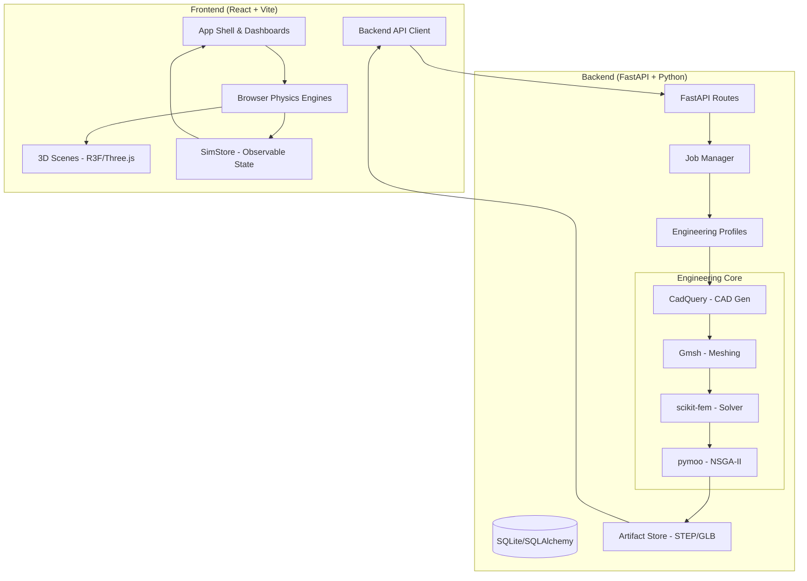

# AutoTwin

**Generative Engineering & Interactive Digital Twins for Automotive Components**

AutoTwin is a high-fidelity virtual-prototyping platform that bridges the gap between real-time interactive visualization and rigorous engineering analysis. It pairs browser-based digital twins with a powerful Python backend for parametric CAD generation, automated meshing, and finite-element analysis (FEA).

---

## 🚗 Project Overview

AutoTwin allows engineers to explore, validate, and optimize automotive components in a unified environment. By linking 3D geometry, live simulation, and traceable engineering results, it builds intuition for how design changes impact performance.

### The Engineering Problem
Engineering design often suffers from "siloed" workflows where CAD models, FEA results, and interactive dashboards are disconnected. AutoTwin solves this by providing **One Source of Truth** for every module, where every number is badged with its provenance (e.g., *Drawing*, *Input*, *Model*, or *Estimated*).

---

## 🛠 Key Features

### 1. Interactive Digital Twins (Browser-Native)
Real-time, time-stepped simulations running at 60 FPS using **Three.js** and **React Three Fiber**.
- **Alloy Wheel**: 5-spoke parametric geometry with live spoke stress visualization, tyre-force load transfer, and cornering/radial fatigue rig estimates.
- **Brake Caliper**: Fixed opposed caliper with moving pistons/pads, hydraulic lag, brake torque limits, and rotor thermal modeling.
- **Spark Plug**: Inline-4 slider-crank kinematics with a 1-3-4-2 firing order and a custom GLSL combustion-fire visualization.

### 2. Generative Engineering (Backend-Powered)
A robust Python backend for high-fidelity studies that go beyond browser-based estimates.
- **Parametric CAD**: Automated generation of `.step` and `.glb` files using **CadQuery**.
- **Automated Meshing**: Seamless transition from CAD to analysis via **Gmsh**.
- **FEA Solvers**: Linear static structural and steady-state thermal analysis powered by **scikit-fem**.
- **Design Exploration**: Multi-objective optimization (NSGA-II) using **pymoo** to find the Pareto front between mass reduction and structural integrity.

### 3. AI Insights & Traceability
- **Validation Engine**: Deterministic PASS/FAIL verdicts based on configurable engineering limits and safety factors.
- **AI Assistant**: Natural-language requirement parsing (Offline keyword extraction or LLM-powered) that proposes structured design constraints.
- **Honest Labeling**: Every reading in the UI carries a badge indicating if it's a direct input, a derived value, a model result, or a demo fixture.

---

## 🏗 System Architecture



---

## 💻 Technology Stack

| Layer | Technologies |
|---|---|
| **Frontend** | React 18, TypeScript 5.6, Vite 5, Zustand, CSS Modules |
| **3D & Visualization** | Three.js 0.169, @react-three/fiber 8, Custom GLSL Shaders |
| **Backend API** | FastAPI 0.162, Uvicorn, SQLAlchemy, Pydantic |
| **Engineering (CAD)** | CadQuery 2.7 (OpenCASCADE kernel) |
| **Engineering (Mesh)** | Gmsh 4.15 |
| **Engineering (FEA)** | scikit-fem 12.0, NumPy, SciPy |
| **Optimization** | pymoo 0.6.2 (NSGA-II) |

---

## 📁 Project Structure

```text
├── Backend/backend/         # Python FastAPI application
│   ├── app/
│   │   ├── api/             # REST endpoints (projects, studies, jobs, assets)
│   │   ├── engineering/     # Core logic (CAD, FEA, Optimization, AI)
│   │   ├── db/              # Persistence layer
│   │   └── services/        # Background workers and job management
│   └── storage/             # Generated artifacts (.step, .glb, results)
├── src/                     # React Frontend source
│   ├── modules/             # Component-specific twins (Wheel, Caliper, Plug)
│   ├── api/                 # Backend client and solver run logic
│   ├── insights/            # AI analysis and recommendation engine
│   ├── workspace/           # Design A/B state and validation rules
│   └── three/               # Shared 3D components and geometry helpers
├── scripts/                 # Node.js validation scripts for frontend logic
├── docs/                    # Architecture diagrams and screenshots
└── package.json             # Frontend dependencies and dev scripts
```

---

## 🚀 Getting Started

### Prerequisites
- **Node.js 22+**
- **Python 3.10+**
- **Gmsh** (required for backend meshing)

### Frontend Setup
```bash
# From the root directory
npm install
npm run dev
```
The frontend will be available at `http://localhost:5173`.

### Backend Setup
```bash
cd Backend/backend
python -m venv .venv
source .venv/bin/activate  # Or .venv\Scripts\activate on Windows
pip install -r requirements.txt
uvicorn app.main:app --reload --port 8000
```
The API documentation will be available at `http://localhost:8000/docs`.

---

## ⚖️ Implementation Status

| Feature | Status | Note |
|---|---|---|
| **Browser Twins** | ✅ Functional | Real-time physics for all 3 modules. |
| **Parametric CAD** | ✅ Functional | Backend generates valid .step files. |
| **FEA Solver** | ✅ Functional | Integrated structural/thermal solvers. |
| **Design Optimization** | ✅ Functional | NSGA-II multi-objective exploration. |
| **AI Insights** | 🟡 Partial | Rule-based logic is active; LLM is optional. |
| **Reports** | ✅ Functional | Markdown and JSON report generation. |

---

## 🛡 Disclaimer
AutoTwin produces virtual-prototyping predictions under an explicitly configured engineering model. Results are not a regulatory certification, not an approval for road use, and not a substitute for physical validation.

---
*Developed as a serious engineering software platform for automotive design exploration.*
